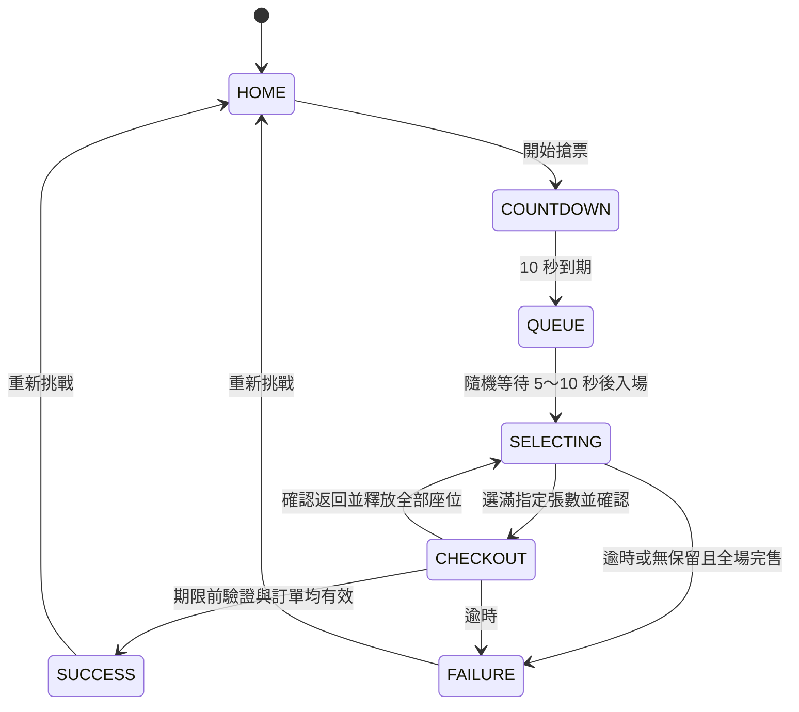

# 遊戲流程與狀態設計

版本：1.0｜2026-10-14｜規格已核可並完成單檔 MVP，流程驗證見 [TEST_REPORT](TEST_REPORT.md)。共通規則依 [PROJECT_SPEC](PROJECT_SPEC.md)，有效席位見 [SEAT_ROWS](SEAT_ROWS.md)。

## 1. 狀態圖

任一階段重新整理／重開皆從 HOME 開始，不恢復本局。未完成局不計勝敗。終局重整仍可從首頁查看已保存紀錄，不必恢復結果畫面。

## 2. 六階段與轉移

| 階段／內部狀態 | 進入時 | 可操作 | 離開條件 |
| --- | --- | --- | --- |
| 首頁 HOME | 讀取完成紀錄，顯示模擬聲明 | 開始、查看紀錄 | 開始建立唯一 runId，進倒數 |
| 開賣 COUNTDOWN | 記錄本局開始時間與 10 秒期限 | 無必要操作 | 期限到，進 QUEUE；不能重複進入 |
| 排隊 QUEUE | 抽起始順位 1～5,000 與獨立隨機 5～10 秒時長 | 查看進度 | 等待完成，依起始順位將初始售出比例由 35% 遞增至 80%，至少留兩席，進 SELECTING |
| 選位 SELECTING | 本局首次進入時目標預設 1 張並設定 120 秒截止時間；從結帳返回時張數與期限皆不重設 | 切分區、選／取消、改張數、確認座位 | 張數已滿且期限有效才進 CHECKOUT |
| 結帳 CHECKOUT | 建立訂單快照與驗證碼 | 輸入、換碼、確認結帳、返回 | 有效提交進 SUCCESS；返回需確認釋放；逾時進 FAILURE |
| 結果 SUCCESS／FAILURE | 原子結算一次、停止本局事件、保存一次紀錄 | 查看票券／原因、重新挑戰 | 回 HOME；下一次開始抽新局 |

首頁查看紀錄使用展開區塊或對話框，不另增遊戲階段。總覽／單區、釋放確認、保留哪席等是介面子狀態，不建立另一個挑戰計時器。

## 3. 期限與耗時

- 按開始時記錄 runStartedAt。
- 進入 SELECTING 時記錄 challengeStartedAt，deadline = challengeStartedAt ＋ 120 秒。
- COUNTDOWN、QUEUE、挑戰期限使用同一個本局時間基準。建議採本頁單調時間計算，避免系統時間調整影響耗時；完成日期另取日曆時間。
- 剩餘時間由 deadline 與當下時間的差計算，下限為零；畫面可向上取整為秒，但提交判定用完整精度。
- 成功／失敗記錄 resultAt。總流程耗時為 resultAt − runStartedAt；選位結帳耗時為 resultAt − challengeStartedAt。
- 逾時結算點使用 deadline，不因分頁晚恢復而記成超過 120 秒的挑戰耗時。完售使用造成無票的售出事件時間。
- 成功以有效提交被處理時的時間為準；動畫播放與紀錄寫入不延長耗時。
- 張數切換、對話框、驗證錯誤、換碼、返回與背景分頁均不暫停。

本頁單調時間在不同裝置休眠時的行為需於測試確認；如果目標環境需要額外補正，應確保時間只能前進，不讓切換時鐘延長挑戰。此處不承諾防作弊。

## 4. 動態售出時程

以 challengeStartedAt 為零點，在 SELECTING 與 CHECKOUT 都執行。**以下取整與交界定義已由使用者確認**：

- 前段於第 4、8、12……56 秒觸發。
- 第 60 秒起進入後段，於 60、62、64……118 秒觸發；60 秒只觸發一次。
- 第 120 秒為逾時，不再安排售出。
- 每次依當下未選可售席數的 1% 向上取整，至少一席；可售池空則跳過。隨機抽樣不重複。
- 已選席不在抽樣池，跨分區與結帳時皆受保留。
- 取消或返回釋放的座位，在後續到期的售出事件才可能被抽中，不回溯售出。
- 重新挑戰建立新排程；清除舊計時回呼並以 runId 防止舊事件污染。

背景分頁恢復或任何玩家輸入時，先按時間順序補算已到期事件，才接受新操作。若歷史事件已觸發完售失敗，使用該終局；否則當下已達期限時判定逾時。這能避免背景停留跳過售出，也讓「先完售、後逾時」保留正確原因。

## 5. 選位、張數與返回

### 選位

1. 總覽選分區 → 顯示該區完整座位；點已選摘要可回對應分區。
2. 操作前先補算時間與售出事件。
3. available 點選後改 selected；selected 再點或摘要取消後改 available。
4. sold 點選不改狀態，提示已售出；已達張數上限則提示先取消另一席。
5. 只要目前 selected 數與目標張數相同，且期限有效，就可確認座位。

### 改張數

- 一張改兩張：保留原席，補選一席後才能結帳。
- 兩張改一張且已選兩席：開啟保留席選擇，確認後才釋放另一席；取消維持原狀。
- 兩張改一張且最多選一席：直接調整目標並保留目前已選席。
- 結帳頁不直接改張數；必須走返回選位流程。

### 返回選位

1. 點返回，顯示「返回將釋放全部已選座位，原座位可能售出，倒數持續」。
2. 取消：停留結帳，座位保留。
3. 確認：先對齊時間與售出事件；若已終局，不再執行返回。
4. 釋放所有已選席、清空訂單與驗證，保留目標張數，回選位總覽。
5. 不重設 deadline、challengeStartedAt、初始順位或售出排程。

## 6. 庫存分流

| 已選／可售情況 | 行為 |
| --- | --- |
| 目標兩張，合計至少兩席 | 正常選位 |
| 目標兩張，合計只剩一席 | 提示可改一張，不自動更改、不立即失敗 |
| 已選一席、其他全售出 | 保留該席；可改一張並結帳 |
| 已選達目標、其他全售出 | 正常結帳，不因場上無其他票而失敗 |
| 已選零席、可售零席 | 立即 FAILURE，原因「座位已全數售出」 |
| 任一進行狀態到期限且未成功 | FAILURE，原因「選位與結帳時間已用完」 |

## 7. 結帳判定順序

先補算到期事件並檢查終局／期限，再驗證輸入、目標張數、座位唯一性、保留狀態與資料內票價。全部成立才一次性進 SUCCESS。換碼或錯碼不是終局。

連點提交只允許一次結算。成功後停止售出、停用互動，以成功快照產出票券，不再從即時可售池取座位。售出席與成功席在終局後不再變更。

若發現內部訂單與座位不一致，停留結帳並提示可返回重選，不默默扣席、改票價或產生錯誤票券；時間繼續。正式測試應排除此錯誤路徑。

## 8. 紀錄與中斷

SUCCESS／FAILURE 各 runId 最多儲存一次；失敗保存原因，不產出票券。最近 10 局包含成功與失敗，最佳只比較成功的選位結帳耗時，依最終實購張數分組。

進行中資料只在記憶體，不從 localStorage 恢復。sessionStorage 可用最小中斷旗標顯示重整提示，但不存完整局。關閉後旗標可能消失，因此首頁固定說明「重新整理或重開將結束未完成挑戰」。中斷不產生失敗紀錄。
